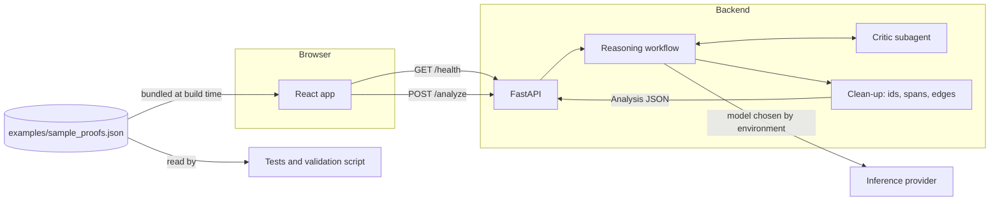

# Hetu

Hetu is an open source reasoning workspace where students write their own arguments and examine the steps, instead of receiving finished solutions.

The name comes from the Sanskrit word हेतु, which is associated with reason, cause, or the ground of an inference.

## Overview

Students often choose between two options. They can work alone and get no feedback on their process. Or they can use a tool that hands over an answer before they have thought the problem through.

Hetu is meant to support the process itself. A student writes rough reasoning in a plain editor. Hetu then shows the steps it recognizes and asks one specific question about a gap, such as a conclusion that does not follow from the steps before it. It does not write the proof.

The first version focuses on short proofs about parity, divisibility, and simple implication.

## Current status

Hetu is a hackathon prototype built for HackPrinceton Fall 2026.

| Area | Status |
| --- | --- |
| Frontend shell with Freeform and Structured views | Working |
| Example exercise with a sample analysis written by hand | Working |
| Backend `GET /health` | Working |
| Backend `POST /analyze` | Working |
| Model workflow | Working. Passed 21 of 21 validation runs on seven short examples |
| Interface connected to `POST /analyze` | Working. Browser tested against a scripted backend |
| Deterministic checks | Not implemented |
| Request limits | Working |
| Public deployment | Configured in `render.yaml`. Not deployed yet |

**Inspect reasoning** sends the draft to the backend, which asks a hosted model to read it. If that fails for the unedited example, the interface shows a sample written by hand and labels it as a sample.

## Features

Implemented today:

- A responsive page with a problem field and a reasoning editor.
- A Freeform and Structured toggle. Switching views never changes the draft.
- A **Try an example** button that loads a parity proof with a gap in it.
- **Inspect reasoning**, which analyzes whatever the student wrote and opens the Structured view.
- A Structured view: the recognized steps, what each step relies on, the passage in question, one question, and an optional hint. When the model finds nothing to question, the view says so.
- Typeset math in questions, hints, and steps. LaTeX such as `$\sqrt{2k}$` is rendered with KaTeX.
- Loading and failure states. A failed analysis never changes or clears the draft.
- Keyboard and screen reader support, described under Accessibility.
- A sample analysis written by hand for the example, shown and labeled as a sample when live analysis fails.
- An API status line that reports whether the backend answers `GET /health`.
- `POST /analyze`, which sends a problem and a draft through a model workflow and returns typed JSON. It caps input length, enforces a timeout, and keeps provider errors out of responses.
- Request limits on `POST /analyze`: a per-client limit per minute and a shared daily limit.
- A script that runs the seven seed examples against the configured model and reports whether each result matches the expected judgment.

### Roadmap

Planned, not built:

- Deterministic checks with SymPy where an expression can be checked.
- Draft recovery through browser `localStorage`.
- Voice input and read aloud, for students who prefer to speak or listen. The current provider also hosts speech models, so this should not need a second service.

## Tech stack

Installed and in use:

| Part | Choice | Why it is here |
| --- | --- | --- |
| Frontend | React, TypeScript, Vite | Component UI with type checking and a fast dev server. |
| Styling | Tailwind CSS | Consistent spacing and color from a small set of tokens in `frontend/src/index.css`. |
| Math | KaTeX | Typesets LaTeX in the model's questions and in steps. It also emits MathML, which screen readers can read. |
| Linting | oxlint | Ships with the Vite React template. |
| Backend | FastAPI, Uvicorn | A small typed HTTP API and the server that runs it. |
| Schemas | Pydantic | Defines the JSON shapes of requests and responses and validates the example fixture. |
| Settings | pydantic-settings, python-dotenv | Read configuration and provider keys from the environment or `backend/.env`. |
| Agent workflow | LangChain Deep Agents | Runs the orchestrator and its critic subagent. |
| Model access | langchain-groq | LangChain's client for models hosted by Groq. |
| Tests | pytest, httpx2 | Test runner and the HTTP client that FastAPI's test client needs. |
| Tooling | npm, uv | Dependency management for the frontend and the backend. |

Planned and not installed yet: SymPy for deterministic checks.

Versions used in testing: Node 22.23, npm 10.9, Python 3.13, uv 0.11 and 0.13, Vite 8.3, React 19.3, Tailwind CSS 4.3, TypeScript 7.0, KaTeX 0.19, FastAPI 0.162, Pydantic 2.14, deepagents 0.7.38, langchain 1.5, langchain-groq 1.1. Exact versions are pinned in `frontend/package-lock.json` and `backend/uv.lock`.

## Architecture

Every line in this diagram exists today.



What happens in one `POST /analyze` request:

1. `backend/app/main.py` checks the input lengths and starts a timer.
2. `backend/app/llm.py` builds the chat model from `HETU_LLM_PROVIDER` and `HETU_LLM_MODEL`. It is the only code that reads those two values.
3. `backend/app/agents.py` runs the workflow. The model splits the draft into quoted steps, says which steps rely on which, and names at most one gap.
4. In the default `deep_agent` workflow, the orchestrator sends a suspected gap to a critic subagent before reporting it. The critic sees the problem with a fresh context and can overrule the suspicion. This is meant to reduce invented errors in correct proofs.
5. `to_analysis` in the same file builds the response without a model. It finds each quoted step in the draft, computes the text spans, drops references to steps that do not exist, and labels the result as not verified.
6. If the Deep Agents attempt fails, for example because the model returned no tool call, the request falls back to the direct workflow described below. That workflow retries itself once.

The direct workflow replaces steps 3 and 4 with a single structured model call and no critic. It uses no tool calling. Setting `HETU_WORKFLOW=direct` makes it the only workflow.

On the frontend:

- The student's problem and draft are held in `frontend/src/App.tsx`. Both views read the same state, so the draft is preserved exactly when the view changes.
- Each analysis is stored with the exact text it was made for. If the student edits the draft afterwards, the Structured view stops showing that analysis.
- `examples/sample_proofs.json` holds seven seed exercises: three correct proofs, two incomplete proofs, and two invalid inferences. The first one includes a sample analysis written by hand.
- The frontend shows that sample only when live analysis fails and the problem and draft match the unedited example.
- `frontend/src/lib/types.ts` mirrors the `Analysis` shape in `backend/app/schemas.py`.

## Local setup

Prerequisites: [Node.js](https://nodejs.org/) 22.12 or newer with npm, and [uv](https://docs.astral.sh/uv/). uv installs the Python version named in `backend/.python-version` if it is missing.

Use two terminals. All paths are relative to the repository root.

Terminal 1, backend:

```bash
cd backend
uv sync
uv run uvicorn app.main:app --reload --port 8000
```

Terminal 2, frontend:

```bash
cd frontend
npm install
npm run dev
```

Open http://localhost:5173. The footer should read "API: connected".

To check the backend directly:

```bash
curl http://localhost:8000/health
```

Expected response: `{"status":"ok"}`

### Environment variables

The app runs without any environment file. `POST /analyze` then answers 503, and everything else works.

To enable analysis, copy the backend example and add a provider key to the copy:

```bash
cp backend/.env.example backend/.env
```

| Variable | Where | Default | Purpose |
| --- | --- | --- | --- |
| `HETU_CORS_ORIGINS` | backend | `http://localhost:5173` | Browser origins allowed to call the API, separated by commas. |
| `HETU_LLM_PROVIDER` | backend | unset | Inference provider, for example `groq`. |
| `HETU_LLM_MODEL` | backend | unset | Model identifier, for example `openai/gpt-oss-120b`. |
| `HETU_LLM_TEMPERATURE` | backend | `0` | Sampling temperature. Low values make repeated runs agree more often. |
| `GROQ_API_KEY` | backend | unset | Key for Groq. Other providers use their own variable. |
| `HETU_WORKFLOW` | backend | `deep_agent` | `deep_agent` (with `direct` as its fallback) or `direct`. |
| `HETU_ANALYZE_TIMEOUT_SECONDS` | backend | `60` | Upper bound on one analysis. |
| `HETU_RATE_LIMIT_PER_MINUTE` | backend | `20` | Requests one client address may make per minute. |
| `HETU_DAILY_ANALYSIS_LIMIT` | backend | `500` | Analyses allowed per day across all clients. |
| `VITE_API_BASE_URL` | frontend | `http://localhost:8000` | Base URL of the API. Set it in `frontend/.env.local`. |

### Validate a model

This step makes real model calls, which the provider may bill.

```bash
cd backend
uv run python -m scripts.validate_model
```

The script runs the seven seed examples. For each run it prints the judgment, the time taken, the token counts, the critic's verdict, and the question. Useful options:

```bash
uv run python -m scripts.validate_model --runs 3
uv run python -m scripts.validate_model --workflow direct
uv run python -m scripts.validate_model --model openai/gpt-oss-20b
uv run python -m scripts.validate_model --only parity
```

To try one request by hand while the backend is running:

```bash
curl -X POST http://localhost:8000/analyze \
  -H "Content-Type: application/json" \
  -d '{"problem": "Prove that the sum of two even integers is even.", "draft": "Let a = 2m and b = 2n. Then a + b = 2(m + n), so a + b is even."}'
```

## Configuration and costs

- API keys belong in `backend/.env` or in the host's environment settings. That file is ignored by Git. Keys are never sent to the browser.
- Any variable that starts with `VITE_` is public. Do not put a secret in one.
- The example configuration uses `openai/gpt-oss-120b` hosted by Groq. `openai/gpt-oss-20b` is a cheaper alternative that did worse in validation.
- Another provider needs its LangChain package, for example `uv add langchain-mistralai`, and its own key variable.
- Open weights do not make inference free. A hosted model is billed by the provider, and student text is sent to that provider.
- One analysis in the `deep_agent` workflow usually makes one to three model calls, and one or two more if it falls back. Provider rate limits apply.
- `POST /analyze` refuses requests over its limits with status 429. The limits are counted in memory, so they reset when the server restarts. Set a spend limit with the provider as well.
- The model weights and the provider APIs are not part of this repository.

## How to use

1. Start the backend and the frontend as described above, with a provider key in `backend/.env`.
2. Select **Try an example**. The problem is: prove that if the integer n² is even, then n is even. The draft reads: "Assume n² = 2k for some integer k. Then n = √(2k), so n must be even."
3. Select **Inspect reasoning**, or press Ctrl+Enter (⌘+Enter on a Mac) in the draft. After a few seconds the Structured view lists the steps the model recognized. The theorem is true, but the draft never shows why n is even, so the model should question that step.
4. Switch back to Freeform and revise the draft, for example with a proof by contrapositive. The draft is exactly as you left it.
5. Inspect again. A complete proof should produce "No question this time."

Without a provider key, step 3 shows the sample written by hand instead, with a note that live analysis failed. For any other draft the interface reports the failure and keeps the draft.

## Accessibility

What the interface does:

- Every control works from the keyboard. Ctrl+Enter, or ⌘+Enter on a Mac, inspects from either text field.
- A skip link at the top of the page jumps to the main content.
- When an analysis arrives, focus moves to its heading, so keyboard and screen reader users land on the result.
- Loading, failure, and API status messages are announced through live regions.
- Math is typeset with MathML alongside the visual output.
- The step in question is marked with an underline and a background, not with color alone, and is labeled for screen readers.
- Transitions are switched off when the system asks for reduced motion.
- Fonts are system fonts and the layout reflows down to a phone width.

How this was checked: automated checks with axe-core reported no violations on the editor, the editor with the example, and the analysis view. The keyboard path was exercised in headless Chrome.

What was not checked: no one has tested the interface with a screen reader such as VoiceOver or NVDA. Automated checks find only some accessibility problems.

## Testing

Backend:

```bash
cd backend
uv run pytest
```

This runs 34 tests without network access or an API key. They cover:

- the health endpoint and the CORS allow list;
- the example fixture's consistency with the `Analysis` schema;
- the clean-up step that builds ids, spans, and edges from a model answer;
- the Deep Agents workflow, with a scripted model standing in for a real one;
- the fallback from the Deep Agents workflow to the direct one, and the direct workflow's single retry;
- the request limits, using a fake clock;
- the request that would be sent to Groq, with the network call replaced;
- `POST /analyze` status codes for success, bad input, timeout, model failure, and missing configuration.

These tests show that the plumbing works. They say nothing about how well a real model judges proofs. That is what the validation script is for.

Frontend:

```bash
cd frontend
npm run build
npm run lint
```

`npm run build` type checks the code and produces a production build. There are no frontend unit tests yet. The interface states were checked by hand in a browser.

### Validation results

These come from `scripts/validate_model` on 14 November 2026, using `openai/gpt-oss-120b` on Groq at temperature 0. Each of the seven examples ran three times.

| Workflow | Runs passed | Average time | Slowest run | Attempts retried |
| --- | --- | --- | --- | --- |
| `deep_agent` | 21 of 21 | 2.5 s | 4.8 s | 1 |
| `direct` | 21 of 21 | 2.2 s | 5.7 s | 3 |

A run passes when the workflow agrees with the fixture on whether the draft has a gap. Read these numbers with care:

- Seven short examples are a smoke test, not a measurement of accuracy.
- The author wrote the examples, and revised the prompts after seeing results on three of them.
- At temperature 0, repeated runs of one example mostly repeat each other.
- A later single pass, after one instruction was reworded, passed 6 of 7. The seventh failed twice in a row because the model returned no tool call. The fallback to the direct workflow was added in response.
- With the fallback and the instruction to write math as LaTeX in place, a pass of two runs per example passed 14 of 14, averaging 2.9 s. The fallback was not triggered. Two of the eight questions contained LaTeX without dollar signs, which the interface still typesets.
- The wording rules for questions and hints were tightened once more after that pass.
- With an earlier prompt, `openai/gpt-oss-20b` passed 6 of 9 runs on three examples and missed the incomplete proof in most of them.

## Deployment

`render.yaml` describes two services for [Render](https://render.com/): the API as a Python web service and the interface as a static site. This configuration has not been deployed yet.

1. Push the repository to GitHub.
2. In the Render dashboard, choose **New > Blueprint** and select the repository.
3. When asked, enter `GROQ_API_KEY`. Leave `HETU_CORS_ORIGINS` and `VITE_API_BASE_URL` empty for now if the dashboard allows it, or enter a placeholder.
4. After both services exist, copy each public URL into the other service's variable, with no trailing slash: the static site's URL into `HETU_CORS_ORIGINS` on `hetu-api`, and the API's URL into `VITE_API_BASE_URL` on `hetu`.
5. Redeploy both services. The static site reads its variable at build time, so it needs a new build.

The blueprint asks for Render's Starter instance for the API. That is a paid plan and it stays awake. To avoid the charge, change `plan: starter` to `plan: free` in `render.yaml`. A free instance sleeps after 15 minutes without traffic and takes about a minute to wake. The interface calls `GET /health` on page load to start that wake-up early and shows "API: starting up" while it waits. The static site is free on either plan.

## Limitations and next steps

- The validation set is seven short examples. Passing it does not show how the model handles longer or less tidy drafts.
- Every judgment is a model's opinion. Nothing is formally verified, and the response says so in its `limitations` field.
- A model can misread a correct proof and report a gap that is not there. The critic step is meant to reduce this. It cannot rule it out.
- The project was tested on Linux and macOS. Nothing was tested on Windows.

Next steps, in order:

1. Deploy, then test the public URL from a phone and from a second network.
2. Try drafts beyond the seed examples and add the instructive ones to the fixture.
3. Add deterministic checks for claims that can be tested, such as searching for a counterexample.

## License

The application code in this repository is licensed under the Apache License 2.0. See `LICENSE` and `NOTICE`.

The license covers this code only. The language models and the inference provider's service are separate works with their own terms, and neither is included here.

## Demo video

TODO: Add the demo thumbnail here and link it to the video.

<!-- When the video exists, replace the TODO line with:
[](VIDEO_URL)
-->
