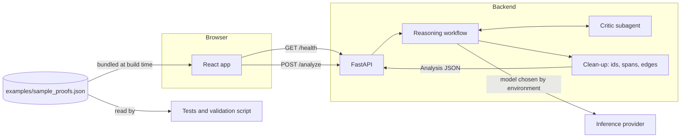

# Hetu

Hetu is a reasoning workspace where students write their own arguments and examine the steps, instead of receiving finished solutions.

The name comes from the Sanskrit word हेतु, which is associated with reason, cause, or the ground of an inference.

## Overview

Students often choose between two options. They can work alone and get no feedback on their process. Or they can use a tool that hands over an answer before they have thought the problem through.

Hetu is meant to support the process itself. A student writes rough reasoning in a plain editor. Hetu then shows the steps it recognizes and asks one specific question about a gap, such as a conclusion that does not follow from the steps before it. It does not write the proof.

The first version focuses on short proofs about parity, divisibility, and simple implication.

## Current status

Hetu is a hackathon prototype built for HackPrinceton Fall 2026.

| Area | Status |
| --- | --- |
| Frontend shell with Freeform and Structured views | Working |
| Example exercise with a sample analysis written by hand | Working |
| Backend `GET /health` | Working |
| Backend `POST /analyze` | Working |
| Model workflow | Runs against models hosted by Groq. Its judgments are not yet consistent |
| Interface connected to `POST /analyze` | Working. Browser tested against a scripted backend |
| Deterministic checks | Not implemented |
| Request limits | Not implemented |
| Public deployment | Not deployed |

**Inspect reasoning** sends the draft to the backend, which asks a hosted model to read it. If that fails for the unedited example, the interface shows a sample written by hand and labels it as a sample.

## Features

Implemented today:

- A responsive page with a problem field and a reasoning editor.
- A Freeform and Structured toggle. Switching views never changes the draft.
- A **Try an example** button that loads a parity proof with a gap in it.
- **Inspect reasoning**, which analyzes whatever the student wrote and opens the Structured view.
- A Structured view: the recognized steps, what each step relies on, the passage in question, one question, and an optional hint. When the model finds nothing to question, the view says so.
- Loading and failure states. A failed analysis never changes or clears the draft.
- A sample analysis written by hand for the example, shown and labeled as a sample when live analysis fails.
- An API status line that reports whether the backend answers `GET /health`.
- `POST /analyze`, which sends a problem and a draft through a model workflow and returns typed JSON. It caps input length, enforces a timeout, and keeps provider errors out of responses.
- A script that runs the seven seed examples against the configured model and reports whether each result matches the expected judgment.

### Roadmap

Planned, not built:

- Deterministic checks with SymPy where an expression can be checked.
- Request limits before any public deployment.
- Draft recovery through browser `localStorage`.
- Math rendering with KaTeX.

## Tech stack

Installed and in use:

| Part | Choice | Why it is here |
| --- | --- | --- |
| Frontend | React, TypeScript, Vite | Component UI with type checking and a fast dev server. |
| Styling | Tailwind CSS | Consistent spacing and color from a small set of tokens in `frontend/src/index.css`. |
| Linting | oxlint | Ships with the Vite React template. |
| Backend | FastAPI, Uvicorn | A small typed HTTP API and the server that runs it. |
| Schemas | Pydantic | Defines the JSON shapes of requests and responses and validates the example fixture. |
| Settings | pydantic-settings, python-dotenv | Read configuration and provider keys from the environment or `backend/.env`. |
| Agent workflow | LangChain Deep Agents | Runs the orchestrator and its critic subagent. |
| Model access | langchain-groq | LangChain's client for models hosted by Groq. |
| Tests | pytest, httpx2 | Test runner and the HTTP client that FastAPI's test client needs. |
| Tooling | npm, uv | Dependency management for the frontend and the backend. |

Planned and not installed yet: SymPy for deterministic checks, KaTeX for math rendering.

Versions used in testing: Node 22.23, npm 10.9, Python 3.13, uv 0.11 and 0.13, Vite 8.3, React 19.3, Tailwind CSS 4.3, TypeScript 7.0, FastAPI 0.162, Pydantic 2.14, deepagents 0.7.38, langchain 1.5, langchain-groq 1.1. Exact versions are pinned in `frontend/package-lock.json` and `backend/uv.lock`.

## Architecture

Every line in this diagram exists today.



What happens in one `POST /analyze` request:

1. `backend/app/main.py` checks the input lengths and starts a timer.
2. `backend/app/llm.py` builds the chat model from `HETU_LLM_PROVIDER` and `HETU_LLM_MODEL`. It is the only code that reads those two values.
3. `backend/app/agents.py` runs the workflow. The model splits the draft into quoted steps, says which steps rely on which, and names at most one gap.
4. In the default `deep_agent` workflow, the orchestrator sends a suspected gap to a critic subagent before reporting it. The critic sees the problem with a fresh context and can overrule the suspicion. This is meant to reduce invented errors in correct proofs.
5. `to_analysis` in the same file builds the response without a model. It finds each quoted step in the draft, computes the text spans, drops references to steps that do not exist, and labels the result as not verified.
6. If an attempt fails, for example because the model produced a malformed tool call, the workflow tries once more.

Setting `HETU_WORKFLOW=direct` replaces steps 3 and 4 with a single structured model call. It uses no tool calling, so it is the fallback if a model handles tools poorly.

On the frontend:

- The student's problem and draft are held in `frontend/src/App.tsx`. Both views read the same state, so the draft is preserved exactly when the view changes.
- Each analysis is stored with the exact text it was made for. If the student edits the draft afterwards, the Structured view stops showing that analysis.
- `examples/sample_proofs.json` holds seven seed exercises: three correct proofs, two incomplete proofs, and two invalid inferences. The first one includes a sample analysis written by hand.
- The frontend shows that sample only when live analysis fails and the problem and draft match the unedited example.
- `frontend/src/lib/types.ts` mirrors the `Analysis` shape in `backend/app/schemas.py`.

## Local setup

Prerequisites: [Node.js](https://nodejs.org/) 22.12 or newer with npm, and [uv](https://docs.astral.sh/uv/). uv installs the Python version named in `backend/.python-version` if it is missing.

Use two terminals. All paths are relative to the repository root.

Terminal 1, backend:

```bash
cd backend
uv sync
uv run uvicorn app.main:app --reload --port 8000
```

Terminal 2, frontend:

```bash
cd frontend
npm install
npm run dev
```

Open http://localhost:5173. The footer should read "API: connected".

To check the backend directly:

```bash
curl http://localhost:8000/health
```

Expected response: `{"status":"ok"}`

### Environment variables

The app runs without any environment file. `POST /analyze` then answers 503, and everything else works.

To enable analysis, copy the backend example and add a provider key to the copy:

```bash
cp backend/.env.example backend/.env
```

| Variable | Where | Default | Purpose |
| --- | --- | --- | --- |
| `HETU_CORS_ORIGINS` | backend | `http://localhost:5173` | Browser origins allowed to call the API, separated by commas. |
| `HETU_LLM_PROVIDER` | backend | unset | Inference provider, for example `groq`. |
| `HETU_LLM_MODEL` | backend | unset | Model identifier, for example `openai/gpt-oss-120b`. |
| `HETU_LLM_TEMPERATURE` | backend | `0` | Sampling temperature. Low values make repeated runs agree more often. |
| `GROQ_API_KEY` | backend | unset | Key for Groq. Other providers use their own variable. |
| `HETU_WORKFLOW` | backend | `deep_agent` | `deep_agent` or `direct`. |
| `HETU_ANALYZE_TIMEOUT_SECONDS` | backend | `60` | Upper bound on one analysis. |
| `VITE_API_BASE_URL` | frontend | `http://localhost:8000` | Base URL of the API. Set it in `frontend/.env.local`. |

### Validate a model

This step makes real model calls, which the provider may bill.

```bash
cd backend
uv run python -m scripts.validate_model
```

The script runs the seven seed examples. For each run it prints the judgment, the time taken, the token counts, the critic's verdict, and the question. Useful options:

```bash
uv run python -m scripts.validate_model --runs 3
uv run python -m scripts.validate_model --workflow direct
uv run python -m scripts.validate_model --model openai/gpt-oss-20b
uv run python -m scripts.validate_model --only parity
```

To try one request by hand while the backend is running:

```bash
curl -X POST http://localhost:8000/analyze \
  -H "Content-Type: application/json" \
  -d '{"problem": "Prove that the sum of two even integers is even.", "draft": "Let a = 2m and b = 2n. Then a + b = 2(m + n), so a + b is even."}'
```

## Configuration and costs

- API keys belong in `backend/.env` or in the host's environment settings. That file is ignored by Git. Keys are never sent to the browser.
- Any variable that starts with `VITE_` is public. Do not put a secret in one.
- The example configuration uses `openai/gpt-oss-120b` hosted by Groq. `openai/gpt-oss-20b` and Mistral Small 4 are alternatives. The validation script exists to compare them.
- Using a Mistral model needs one extra package: `uv add langchain-mistralai`.
- Open weights do not make inference free. A hosted model is billed by the provider, and student text is sent to that provider.
- One analysis in the `deep_agent` workflow usually makes one to three model calls. Provider rate limits apply.
- The API has no request limit yet. Do not deploy it publicly with a key until one is added.
- The model weights and the provider APIs are not part of this repository.

## How to use

1. Start the backend and the frontend as described above, with a provider key in `backend/.env`.
2. Select **Try an example**. The problem is: prove that if the integer n² is even, then n is even. The draft reads: "Assume n² = 2k for some integer k. Then n = √(2k), so n must be even."
3. Select **Inspect reasoning**. After a few seconds the Structured view lists the steps the model recognized. The theorem is true, but the draft never shows why n is even, so the model should question that step.
4. Switch back to Freeform and revise the draft, for example with a proof by contrapositive. The draft is exactly as you left it.
5. Inspect again. A complete proof should produce "No question this time."

Without a provider key, step 3 shows the sample written by hand instead, with a note that live analysis failed. For any other draft the interface reports the failure and keeps the draft.

## Testing

Backend:

```bash
cd backend
uv run pytest
```

This runs 27 tests without network access or an API key. They cover:

- the health endpoint and the CORS allow list;
- the example fixture's consistency with the `Analysis` schema;
- the clean-up step that builds ids, spans, and edges from a model answer;
- the Deep Agents workflow, with a scripted model standing in for a real one;
- the single retry after a failed attempt;
- the request that would be sent to Groq, with the network call replaced;
- `POST /analyze` status codes for success, bad input, timeout, model failure, and missing configuration.

These tests show that the plumbing works. They say nothing about how well a real model judges proofs. That is what the validation script is for.

Frontend:

```bash
cd frontend
npm run build
npm run lint
```

`npm run build` type checks the code and produces a production build. There are no frontend unit tests yet. The interface states were checked by hand in a browser.

## Limitations and next steps

- The model's judgments are not yet consistent. In the first runs on three examples, `gpt-oss-120b` caught the incomplete proof more reliably than `gpt-oss-20b`. Both models questioned a correct proof in some runs. The prompts have been revised since and have not been measured again.
- Every judgment is a model's opinion. Nothing is formally verified, and the response says so in its `limitations` field.
- A model can misread a correct proof and report a gap that is not there. The critic step is meant to reduce this. It cannot rule it out.
- Seven seed examples are too few to measure reliability.
- The project was tested on Linux and macOS. Nothing was tested on Windows.

Next steps, in order:

1. Rerun the validation script with the revised prompts and pick a model and workflow.
2. Add request limits, then deploy.

## License

No license has been chosen yet. The intent is to release the application code under a permissive open source license. Until a `LICENSE` file is added, the code is not licensed for reuse.

## Demo video

TODO: Add the demo thumbnail here and link it to the video.

<!-- When the video exists, replace the TODO line with:
[](VIDEO_URL)
-->
