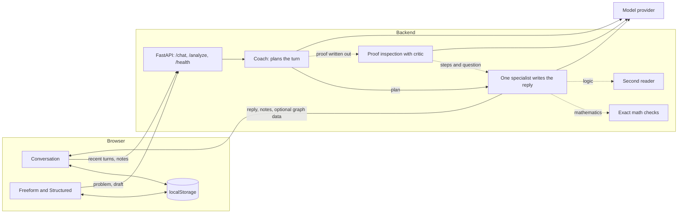

# Hetu

Hetu is an open source learning environment. A student types what they want to understand, in any academic subject, and Hetu works out what kind of help fits that moment: an explanation, an example, a hint, a question about their reasoning, or a second look at its own feedback.

Live site: https://hetu-cin8.onrender.com

The name comes from the Sanskrit word हेतु, which is associated with reason, cause, or the ground of an inference.

## Educational purpose

Most AI tools respond the same way to every message. A chatbot explains. A Socratic tutor asks questions. A checker looks for mistakes. Each fails when the student needs one of the other two.

Hetu decides first and answers second. A student who says "I have no idea how classes work" is taught. A student who writes out a proof gets feedback on the step that does not follow, without the proof being finished for them. A student who disagrees with that feedback gets a real reconsideration.

## Features

- **Conversation.** The main view is a chat that keeps context across turns. Replies render Markdown, typeset math, and formatted code.
- **Adaptive strategy.** Each turn starts with a plan: what the student needs, what Hetu should do, and who should answer. The plan can change from turn to turn.
- **Five specialists.** Mathematics, science, programming, writing and humanities, and logic. Each has its own instructions. Only the one that fits a turn is used, unless a question spans two subjects.
- **Exact checks in mathematics.** The mathematics specialist can search integers for a counterexample and compare two expressions symbolically. Results are shown apart from the reply and labelled as computed.
- **A second reader in logic.** Before the logic specialist tells a student their argument has a flaw, a second agent checks whether the flaw is really there.
- **Proof inspection.** When a student writes out a mathematical argument, Hetu splits it into steps, records what each step relies on, and questions at most one step.
- **Reasoning graph.** An inspected proof can be opened as a graph. Steps can be selected, revised, or challenged. The graph is offered only when a proof was inspected.
- **Workspace.** Freeform is an editor for longer work. A draft can be inspected there or taken into the conversation.
- **Session notes.** Hetu keeps short notes on the topic, the goal, and what the student has shown so far. The student can read them. They are described as guesses.
- **Saved sessions.** The conversation and the workspace are kept in the browser and restored on reload. **New session** clears the conversation.
- **Accessibility.** Keyboard access throughout, a skip link, live regions for status, a text version of the graph, and reduced motion.

## Architecture



One `POST /chat` turn, in `backend/app/tutor.py`:

1. **Plan.** The coach reads the conversation and the session notes and returns a typed plan. This is one structured model call.
2. **Inspect, when called for.** If the plan says the student wrote out a proof, the inspection in `backend/app/agents.py` runs. An orchestrator splits the argument into steps, and a critic subagent can overrule a suspected gap. If the student disputes an earlier question, the inspection runs again with their reason.
3. **Reply.** The specialist named in the plan writes the reply. Specialists are LangChain Deep Agents. Mathematics has tools, logic has a second reader, and a lead can consult another specialist when the plan names one.

Design decisions:

- **Code routes, the model plans.** The model fills in the plan, and ordinary code acts on it. Routing does not depend on a model choosing to call a tool, which is where the current model fails most often.
- **Few calls.** An ordinary turn is two model calls: the plan and the reply. A proof turn adds one to three for the inspection.
- **Fallbacks.** If the plan cannot be parsed twice, Hetu answers without specialist routing. If a specialist run fails, the same instructions are used in one plain call. If the inspection fails, the specialist is told to give feedback from its own reading.
- **The student's text is never rewritten.** The inspection runs on what the student wrote. If the model's copy of the proof differs from the message, the message itself is used.
- **No server-side sessions and no database.** Each request carries the recent turns and the notes. The browser stores them. A database would add accounts, access control, and hosting for little gain at this stage.
- **No code execution.** The programming specialist explains and traces code by reasoning. Running student code safely needs a sandbox, which is out of scope.

## Technology stack

| Part | Choice | Why it is here |
| --- | --- | --- |
| Frontend | React, TypeScript, Vite | Component UI with type checking. |
| Styling | Tailwind CSS | A small set of design tokens in `frontend/src/index.css`. |
| Reply rendering | react-markdown, remark-gfm, remark-math, rehype-katex, KaTeX | Markdown, tables, math, and code in replies. Raw HTML in a reply is not rendered. |
| Backend | FastAPI, Uvicorn, Pydantic | A typed HTTP API. |
| Agents | LangChain Deep Agents | Specialists with their own tools and subagents, and the proof orchestrator with its critic. |
| Math checks | SymPy | Symbolic comparison of expressions. |
| Model access | langchain-groq | Client for models hosted by Groq. The default is `openai/gpt-oss-120b`, an open weight model. |
| Settings | pydantic-settings, python-dotenv | Configuration from the environment or `backend/.env`. |
| Tests | pytest, httpx2, Vitest, Testing Library | No automated test calls a model. |

## Local setup

Prerequisites: [Node.js](https://nodejs.org/) 22.12 or newer and [uv](https://docs.astral.sh/uv/).

Backend, from the repository root:

```bash
cd backend
cp .env.example .env
uv sync
uv run uvicorn app.main:app --reload --port 8000
```

Put a provider key in `backend/.env` first. Without one the server runs, and `POST /chat` answers 503.

Frontend, in a second terminal:

```bash
cd frontend
npm install
npm run dev
```

Open http://localhost:5173.

## Configuration

| Variable | Default | Purpose |
| --- | --- | --- |
| `HETU_LLM_PROVIDER` | unset | Model provider, for example `groq`. |
| `HETU_LLM_MODEL` | unset | Model identifier, for example `openai/gpt-oss-120b`. |
| `GROQ_API_KEY` | unset | Key for Groq. Another provider uses its own variable and needs its LangChain package. |
| `HETU_LLM_TEMPERATURE` | `0` | Sampling temperature. |
| `HETU_WORKFLOW` | `deep_agent` | How a proof is inspected: `deep_agent`, or `direct` for a single call with no critic. |
| `HETU_ANALYZE_TIMEOUT_SECONDS` | `60` | Upper bound on one chat turn or one analysis. |
| `HETU_CORS_ORIGINS` | `http://localhost:5173` | Browser origins allowed to call the API, separated by commas. |
| `HETU_RATE_LIMIT_PER_MINUTE` | `20` | Requests one client address may make per minute. |
| `HETU_DAILY_ANALYSIS_LIMIT` | `500` | Requests allowed per day across all clients. |
| `HETU_TRUSTED_PROXY_HOPS` | `0` | Proxies in front of the server that append to `X-Forwarded-For`. |
| `VITE_API_BASE_URL` | `http://localhost:8000` | Frontend only. Set it in `frontend/.env.local`. |

No model or provider is named in the learning logic. `backend/app/llm.py` is the only code that reads the provider and model.

Security and cost:

- Provider keys stay on the server. `backend/.env` is ignored by Git. Any `VITE_` variable is public.
- Student messages are sent to the model provider.
- Expressions for the math checks come from a model, so they are treated as untrusted. They are parsed into a syntax tree and only arithmetic is accepted. Nothing is passed to `eval`.
- Error responses never include provider details.
- The request limits are counted in memory and reset on restart. One request can make several model calls. The limits slow spending down and do not cap it, so set a spend limit with the provider.

`render.yaml` describes the two services behind the live site.

## Testing

```bash
cd backend
uv run pytest
```

110 tests. They cover the plan and routing for each kind of turn, conversation context, proof inspection from a message and from the workspace, challenges, specialist tools and consultation, the fallbacks, the math checks including unsafe input, both endpoints, and the request limits.

```bash
cd frontend
npm test
npm run build
npm run lint
```

86 tests. They cover the conversation, Markdown, math and code rendering, session saving, opening a proof as a graph, sharing a draft, the reasoning graph, revise and challenge, and discarding stale results.

These tests use scripted model replies. They show that the application acts correctly on a given plan. They do not show that a real model plans well or teaches well.

To see real behavior, which the provider may bill:

```bash
cd backend
uv run python -m scripts.evaluate_scenarios
```

This runs seven scenarios, about eleven turns: foundational confusion, a flawed proof, a weak generalization, a science question, an essay thesis, a conversation that changes direction, and a challenge to Hetu's feedback. It prints each reply with a few automatic checks on the routing. Judging the teaching needs a person to read the replies.

`scripts.validate_model` runs the proof inspection alone on seven seed proofs.

## Limitations

- Hetu is a language model. It can state something false, question a correct step, or miss a real problem. Nothing is formally verified.
- The scenario script checks routing, not teaching quality. No study with students has been done.
- The plan is one model call. A wrong plan gives the wrong kind of help for that turn. The student can redirect it in the next message.
- The math checks are narrow: integer searches in a small range and symbolic comparison of expressions. A search that finds no counterexample is evidence, not a proof.
- Session notes are rough guesses from one conversation. They do not measure what a student knows.
- A request carries at most the last 24 messages, so very long sessions lose their beginning.
- Sessions are saved only in the current browser. There are no accounts.
- The reasoning graph exists only for mathematical arguments. Essays and everyday arguments get written feedback.
- Hetu cannot run code, browse, or read files and images.
- When a challenge itself contains the missing argument, Hetu may withdraw its question even though the written proof still lacks it.
- Automated accessibility checks pass. The interface has not been tested with a screen reader.

## License

The application code is licensed under the Apache License 2.0. See `LICENSE` and `NOTICE`.

The license covers this code only. The language models and the provider's service are separate works with their own terms, and neither is included here.
