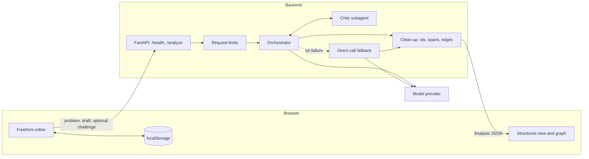

# Hetu

Hetu is an open source learning environment that helps students examine their own reasoning. A student writes a proof in their own words. Hetu maps the steps, shows how they depend on each other, and asks one question about a possible gap. It does not write the proof.

Live site: https://hetu-cin8.onrender.com

The name comes from the Sanskrit word हेतु, which is associated with reason, cause, or the ground of an inference.

## The educational problem

Students often choose between two options. They can work alone and get no feedback on their process. Or they can use a tool that hands over an answer before they have thought the problem through.

Neither option helps a student see where their own argument is weak and repair it themselves.

## What Hetu does

Hetu has two views of the same work.

- **Freeform** is a plain editor for the problem and the student's reasoning.
- **Structured** shows what Hetu read in that reasoning: the steps, what each step relies on, and at most one question about a step that may not follow.

The student's text is the source of truth. Switching views never changes it, and an analysis is shown only while it matches the current text.

The current version focuses on short proofs about parity, divisibility, and simple implication.

## Main features

- **Reasoning graph.** Steps are drawn as connected boxes. Arrows run from a step to the steps that rely on it. Assumptions, claims, inferences, and conclusions have different borders, and a step with a question is marked.
- **Step detail.** Selecting a step in the graph or in the text list shows its full statement, what it relies on, what uses it, and any question about it. The matching passage in the draft is highlighted.
- **Revise this step.** Returns to the editor with that step's text selected.
- **Challenge Hetu.** The student explains why a questioned step is justified. Hetu reads the draft again with that explanation and either withdraws the question or says what is still missing.
- **One question, no solutions.** The model is instructed to ask about a gap without stating the missing argument. A hint is available on request.
- **Honest labels.** Every result is marked as a model's judgment. A step without a question is described as unquestioned, not as correct.
- **Saved drafts.** The problem and draft are kept in the browser's `localStorage` and restored on reload. **Clear workspace** removes them.
- **Typeset math.** LaTeX in questions, hints, and steps is rendered with KaTeX.
- **Keyboard and screen reader support.** A skip link, focus that moves to new results, arrow keys in the graph, a text version of the graph, and reduced motion.
- **Fallback sample.** If live analysis fails for the built-in example, a sample written by hand is shown and labelled as a sample.

## Technology stack

| Part | Choice | Why it is here |
| --- | --- | --- |
| Frontend | React, TypeScript, Vite | Component UI with type checking and a fast dev server. |
| Styling | Tailwind CSS | Consistent spacing and color from a small set of tokens in `frontend/src/index.css`. |
| Math | KaTeX | Typesets LaTeX and emits MathML for screen readers. |
| Backend | FastAPI, Uvicorn, Pydantic | A small typed HTTP API. Pydantic defines the request and response shapes. |
| Agent workflow | LangChain Deep Agents | Runs an orchestrator that can consult a critic subagent before reporting a gap. |
| Model access | langchain-groq | Client for models hosted by Groq. The default is `openai/gpt-oss-120b`, an open weight model. |
| Settings | pydantic-settings, python-dotenv | Read configuration and provider keys from the environment or `backend/.env`. |
| Tests | pytest, httpx2, Vitest, Testing Library | Backend and frontend tests. None of them calls a model. |
| Tooling | uv, npm, oxlint | Dependency management and linting. |

The graph is drawn with plain HTML and SVG. Its layout is a small pure function in `frontend/src/lib/graph.ts`, so no graph library is needed.

## Architecture



One `POST /analyze` request:

1. `backend/app/main.py` checks the input sizes and the request limits.
2. `backend/app/llm.py` builds the chat model from `HETU_LLM_PROVIDER` and `HETU_LLM_MODEL`. No other code names a provider.
3. `backend/app/agents.py` runs the workflow. The orchestrator splits the draft into quoted steps and looks for one gap. Before reporting a gap it asks a critic subagent, which reads the draft with a fresh context and can overrule it.
4. If the orchestrator fails, for example because the model returns no tool call, a single direct model call answers instead.
5. `to_analysis` builds the response without a model. It finds each quoted step in the draft and computes its position. A step whose wording is not in the draft gets no position and is never highlighted.

A challenge uses the same endpoint and the same workflow. The request carries the questioned step, the question, and the student's explanation.

## Local installation and setup

Prerequisites: [Node.js](https://nodejs.org/) 22.12 or newer and [uv](https://docs.astral.sh/uv/). uv installs the right Python version if it is missing.

Backend, from the repository root:

```bash
cd backend
cp .env.example .env
uv sync
uv run uvicorn app.main:app --reload --port 8000
```

Put a provider key in `backend/.env` before starting. Without a key the server still runs, and `POST /analyze` answers 503.

Frontend, in a second terminal:

```bash
cd frontend
npm install
npm run dev
```

Open http://localhost:5173. The footer shows "API: connected" when the backend is reachable.

### Environment variables

| Variable | Default | Purpose |
| --- | --- | --- |
| `HETU_LLM_PROVIDER` | unset | Model provider, for example `groq`. |
| `HETU_LLM_MODEL` | unset | Model identifier, for example `openai/gpt-oss-120b`. |
| `GROQ_API_KEY` | unset | Key for Groq. Another provider uses its own variable and needs its LangChain package. |
| `HETU_LLM_TEMPERATURE` | `0` | Sampling temperature. |
| `HETU_WORKFLOW` | `deep_agent` | `deep_agent`, or `direct` to skip the orchestrator and critic. |
| `HETU_ANALYZE_TIMEOUT_SECONDS` | `60` | Upper bound on one analysis. |
| `HETU_CORS_ORIGINS` | `http://localhost:5173` | Browser origins allowed to call the API, separated by commas. |
| `HETU_RATE_LIMIT_PER_MINUTE` | `20` | Requests one client address may make per minute. |
| `HETU_DAILY_ANALYSIS_LIMIT` | `500` | Analyses allowed per day across all clients. |
| `HETU_TRUSTED_PROXY_HOPS` | `0` | Proxies in front of the server that append to `X-Forwarded-For`. |
| `VITE_API_BASE_URL` | `http://localhost:8000` | Frontend only. Base URL of the API. Set it in `frontend/.env.local`. |

### Security and cost

- Provider keys stay on the server. `backend/.env` is ignored by Git.
- Any variable that starts with `VITE_` is public. Never put a secret in one.
- The API lists its allowed origins explicitly and sends no credentials.
- Error responses never include provider details. Those go to the server log.
- Student text is sent to the model provider.
- The request limits slow abuse down. They are counted in memory, reset on restart, and do not cap the provider bill. Set a spend limit with the provider.
- With `HETU_TRUSTED_PROXY_HOPS=0` the forwarded header is ignored. Behind a proxy, only the entries that the trusted proxies appended are used, so a client cannot pick its own address.

### Deployment

`render.yaml` describes the two services used for the live site: the API as a Python web service and the interface as a static site.

## Testing

```bash
cd backend
uv run pytest
```

56 tests. They cover the API status codes, request limits, the forwarded header handling, the clean-up of model output, source positions for matched and unmatched steps, the challenge outcomes, and both workflows with a scripted model.

```bash
cd frontend
npm test
npm run build
npm run lint
```

65 tests. They cover the graph layout and arrow direction, selecting steps with and without a question, the revise and challenge interactions, discarding a response that arrives after the draft changed, saving and restoring drafts, and the API status line.

No automated test calls a model. To check a live model, which the provider may bill:

```bash
cd backend
uv run python -m scripts.validate_model
uv run python -m scripts.validate_model --challenges
```

The first command runs seven seed proofs from `examples/sample_proofs.json`. The second runs three scripted challenges.

## Known limitations

- Every judgment comes from a language model. Nothing is formally verified, and a model can question a correct step or miss a real gap.
- The validation set is seven short proofs. It does not show how the model handles longer or less tidy drafts.
- Hetu reports at most one question per analysis.
- A challenge is a fresh analysis with the student's explanation added. Hetu keeps no memory of earlier exchanges.
- A step is located only when its wording appears in the draft. Steps that the model rephrased are listed without a highlight.
- The dependency arrows are the model's reading. Missing or extra arrows are possible.
- Drafts are saved only in the current browser. There are no accounts and nothing is synced.
- Behind several proxies, the per-client limit depends on `HETU_TRUSTED_PROXY_HOPS` matching the hosting setup. If it does not, clients share a limit.
- Automated accessibility checks pass. The interface has not been tested with a screen reader.
- Only short mathematical proofs are supported.

## Demo video

TODO: Add the demo thumbnail here and link it to the video.

<!-- When the video exists, replace the TODO line with:
[](VIDEO_URL)
-->

## License

The application code is licensed under the Apache License 2.0. See `LICENSE` and `NOTICE`.

The license covers this code only. The language models and the provider's service are separate works with their own terms, and neither is included here.
