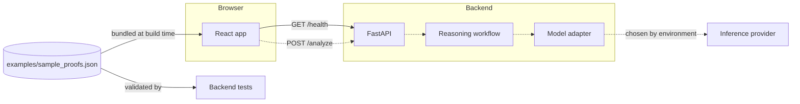

# Hetu

Hetu is a reasoning workspace where students write their own arguments and examine the steps, instead of receiving finished solutions.

The name comes from the Sanskrit word हेतु, which is associated with reason, cause, or the ground of an inference.

## Overview

Students often choose between two options. They can work alone and get no feedback on their process. Or they can use a tool that hands over an answer before they have thought the problem through.

Hetu is meant to support the process itself. A student writes rough reasoning in a plain editor. Hetu then shows the steps it recognizes and asks one specific question about a gap, such as a conclusion that does not follow from the steps before it. It does not write the proof.

The first version focuses on short proofs about parity, divisibility, and simple implication.

## Current status

Hetu is a hackathon prototype built for HackPrinceton Fall 2026. This repository currently contains the scaffold only.

| Area | Status |
| --- | --- |
| Frontend shell with Freeform and Structured views | Working |
| Example exercise with a sample analysis written by hand | Working |
| Backend `GET /health` | Working |
| Backend `POST /analyze` | Not implemented |
| Model inference and agent workflow | Not implemented |
| Deterministic checks | Not implemented |
| Public deployment | Not deployed |

No model is called anywhere in the current code. The only analysis the app can show is a fixture written by hand, and the interface labels it as a sample.

## Features

Implemented today:

- A responsive page with a problem field and a reasoning editor.
- A Freeform and Structured toggle. Switching views never changes the draft.
- A **Try an example** button that loads a parity proof with a gap in it.
- A Structured view of that example: the recognized steps, what each step relies on, the passage in question, one question, and an optional hint. This content is written by hand and labeled as a sample.
- An API status line that reports whether the backend answers `GET /health`.

### Roadmap

Planned, not built:

- `POST /analyze`, which returns the structure of any draft as typed JSON.
- Analysis by an agent workflow built on LangChain Deep Agents with an open weight model.
- Deterministic checks with SymPy where an expression can be checked.
- Loading, timeout, and failure states for analysis requests.
- Draft recovery through browser `localStorage`.
- Math rendering with KaTeX.
- Request limits and input length caps before any public deployment.

## Tech stack

Installed and in use:

| Part | Choice | Why it is here |
| --- | --- | --- |
| Frontend | React, TypeScript, Vite | Component UI with type checking and a fast dev server. |
| Styling | Tailwind CSS | Consistent spacing and color from a small set of tokens in `frontend/src/index.css`. |
| Linting | oxlint | Ships with the Vite React template. |
| Backend | FastAPI, Uvicorn | A small typed HTTP API and the server that runs it. |
| Schemas | Pydantic | Defines the JSON shapes the API returns and validates the example fixture. |
| Settings | pydantic-settings | Reads configuration from environment variables or `backend/.env`. |
| Tests | pytest, httpx2 | Test runner and the HTTP client that FastAPI's test client needs. |
| Tooling | npm, uv | Dependency management for the frontend and the backend. |

Planned and not installed yet: LangChain Deep Agents for the agent workflow, a hosted open weight model for inference, SymPy for deterministic checks, KaTeX for math rendering.

Versions used when the scaffold was tested: Node 22.23, npm 10.9, Python 3.13, uv 0.11, Vite 8.3, React 19.3, Tailwind CSS 4.3, TypeScript 7.0, FastAPI 0.162, Pydantic 2.14. Exact versions are pinned in `frontend/package-lock.json` and `backend/uv.lock`.

## Architecture

Solid lines exist today. Dashed lines are planned.



How the current code fits together:

- The student's problem and draft are held in `frontend/src/App.tsx`. Both views read the same state, so the draft is preserved exactly when the view changes.
- `examples/sample_proofs.json` holds three seed exercises: one correct proof, one incomplete proof, and one invalid inference. The incomplete one includes a sample analysis written by hand.
- The frontend shows that sample only when the problem and draft match the unedited example. Any other draft gets a message that live analysis is not connected.
- `backend/app/schemas.py` defines the draft `Analysis` shape that `POST /analyze` will return. A backend test validates the sample against it. `frontend/src/lib/types.ts` mirrors the same shape.

How model selection is designed to work:

- The provider and model are read from `HETU_LLM_PROVIDER` and `HETU_LLM_MODEL` in `backend/app/config.py`.
- A model adapter will be the only code that reads those values and builds a chat model. The reasoning workflow will receive that model and will not name a provider.
- Changing the model should then require a change to the environment only. This adapter does not exist yet.

## Local setup

Prerequisites: [Node.js](https://nodejs.org/) 22.12 or newer with npm, and [uv](https://docs.astral.sh/uv/). uv installs the Python version named in `backend/.python-version` if it is missing.

Use two terminals. All paths are relative to the repository root.

Terminal 1, backend:

```bash
cd backend
uv sync
uv run uvicorn app.main:app --reload --port 8000
```

Terminal 2, frontend:

```bash
cd frontend
npm install
npm run dev
```

Open http://localhost:5173. The footer should read "API: connected".

To check the backend directly:

```bash
curl http://localhost:8000/health
```

Expected response: `{"status":"ok"}`

### Environment variables

Both parts run with defaults, so the files below are optional for the scaffold.

```bash
cp backend/.env.example backend/.env
cp frontend/.env.example frontend/.env.local
```

| Variable | Where | Default | Purpose |
| --- | --- | --- | --- |
| `HETU_CORS_ORIGINS` | backend | `http://localhost:5173` | Browser origins allowed to call the API, separated by commas. |
| `HETU_LLM_PROVIDER` | backend | unset | Inference provider. Not read by any code yet. |
| `HETU_LLM_MODEL` | backend | unset | Model identifier. Not read by any code yet. |
| `GROQ_API_KEY`, `MISTRAL_API_KEY` | backend | unset | Provider keys. Not read by any code yet. |
| `VITE_API_BASE_URL` | frontend | `http://localhost:8000` | Base URL of the API. |

## Configuration and costs

- API keys belong in `backend/.env` or in the host's environment settings. That file is ignored by Git. Keys are never sent to the browser.
- Any variable that starts with `VITE_` is public. Do not put a secret in one.
- No model has been selected. The first candidate is `openai/gpt-oss-20b` hosted by Groq. The alternatives are `openai/gpt-oss-120b` on Groq and Mistral Small 4. Each still has to be tested for reasoning quality, structured output, and tool calling with Deep Agents.
- Open weights do not make inference free. A hosted model is billed by the provider, and student text is sent to that provider.
- The current code makes no model calls and costs nothing to run locally.
- The model weights and the provider APIs are not part of this repository.

## How to use

1. Start the backend and the frontend as described above.
2. Select **Try an example**. The problem is: prove that if the integer n² is even, then n is even. The draft reads: "Assume n² = 2k for some integer k. Then n = √(2k), so n must be even."
3. Select **Inspect reasoning**. The Structured view lists three steps and marks the last one, "so n must be even."
4. Read the question: why does taking the square root of 2k establish that n is divisible by two? The theorem is true. The draft's reasoning is incomplete.
5. Switch back to Freeform. The draft is unchanged.

If you edit the draft, **Inspect reasoning** is disabled. The sample was written for the unedited example only, and live analysis does not exist yet.

## Testing

Backend:

```bash
cd backend
uv run pytest
```

This runs six tests. They cover the health endpoint, the CORS allow list, and the consistency of the example fixture with the `Analysis` schema, including that every text span points at the text it quotes.

Frontend:

```bash
cd frontend
npm run build
npm run lint
```

`npm run build` type checks the code and produces a production build. There are no frontend unit tests yet.

## Limitations and next steps

- Hetu cannot analyze a student's own draft yet. Only the sample for the unedited example is available.
- The sample analysis was written by a person. It says nothing about how well a model will perform.
- The `Analysis` schema is a draft and may change once real model output is tested.
- Nothing is formally verified. When checks are added, SymPy will be able to confirm some expressions, not whole proofs.
- The scaffold was tested on Linux and macOS. It has not been tested on Windows.

Next steps, in order:

1. Validate one end to end analysis with Deep Agents and a candidate model on the three seed examples.
2. Implement `POST /analyze` and connect the interface to it.
3. Add loading, timeout, and failure states.
4. Add request limits, then deploy.

## License

No license has been chosen yet. The intent is to release the application code under a permissive open source license. Until a `LICENSE` file is added, the code is not licensed for reuse.

## Demo video

TODO: Add the demo thumbnail here and link it to the video.

<!-- When the video exists, replace the TODO line with:
[](VIDEO_URL)
-->
