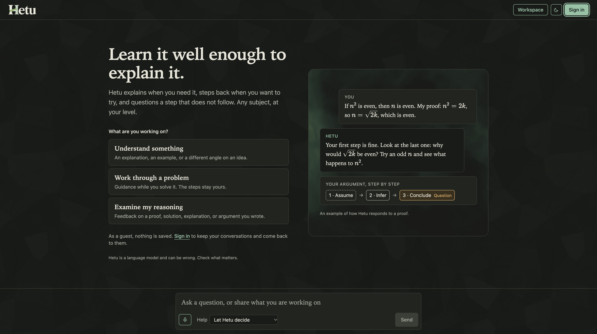
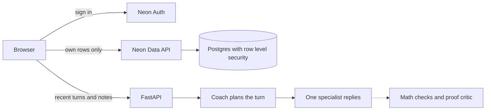

# Hetu

   

**An AI learning companion that knows when to explain and when to step back.**

Live: https://hetu-cin8.onrender.com

हेतु (hetu) is Sanskrit for reason, or the ground of an inference. That is what Hetu helps students build.

## The problem

AI makes it easy to get an answer and easy to skip the learning. Most tools respond the same way to every message. A chatbot explains everything. A Socratic tutor only asks questions. A checker only looks for mistakes. Each one fails the moment a student needs one of the others.

Real tutors adapt. They explain when you are lost. They hold back when you are close. They point at the exact step that does not follow and let you fix it yourself.

## What Hetu does

Hetu decides how to help before it answers.

- **Lost?** Hetu explains, with an example at your level.
- **Working through a problem?** Hetu gives a hint and leaves the steps to you.
- **Wrote a proof or an argument?** Hetu finds the step that does not follow and asks about it. It does not finish the work for you.
- **Think Hetu is wrong?** Say so. It reconsiders for real instead of repeating itself.

Students can also choose the kind of help directly: explain, hint, check my reasoning, example, let me try, or challenge my assumption. Hetu works across mathematics, science, programming, writing, the humanities, and logic.

## Features

**Learning**
- Three starting points: understand something, work through a problem, or examine my reasoning.
- Session notes track what was discussed, what the student showed, and possible misconceptions. Students can remove any note and Hetu respects that.
- Exact math checks with SymPy. Counterexamples and symbolic comparisons are computed, not guessed, and shown apart from the reply.
- Function plots drawn in the browser. The curve is computed point by point, so it is exact.
- Typeset math, code, and tables in every reply.

**Workspace**
- A draft panel beside the conversation for longer work. Ask for feedback on the whole draft or on a selection.
- **Map the steps** turns a proof into a graph of how each step depends on the others. Any step can be revised, questioned, or challenged.

**Voice**
- Dictate a message, then edit it before sending.
- Listen to any reply, with pause and stop.

**Accounts**
- Use Hetu right away as a guest. Nothing is saved to the server.
- Sign in with Google, GitHub, or email to keep conversations, notes, and drafts.
- Guest work moves to an account only if the student says yes. **Delete my data** removes everything.

**Interface**
- A paper texture and serif type that feel like a notebook, not a dashboard.
- Light and dark themes. Replies appear a few words at a time and the view stays at the start of each reply.
- Keyboard access, screen reader labels, and reduced motion support throughout.

## How it works



Each turn has three steps.

1. **Plan.** A coach reads the conversation and returns a typed plan: what the student needs, what Hetu should do, and which specialist should answer.
2. **Inspect.** If the student wrote a proof, it is split into steps. A critic agent double checks any gap before Hetu mentions it.
3. **Reply.** The chosen specialist writes the answer, with its own tools.

The model plans and ordinary code acts on the plan. If the student picks a kind of help, code enforces it. An ordinary turn takes two model calls.

## Why these tools

| Tool | Why |
| --- | --- |
| **React and TypeScript** | The interface has many moving parts: a conversation, a workspace, a graph, and accounts. Types keep the browser in step with the API. |
| **Vite** | Instant reloads in development and a small static build. |
| **Tailwind CSS** | Every color is a token in one file. Themes swap values, so dark mode has no stray colors. |
| **KaTeX and react-markdown** | Math looks like a textbook. Raw HTML in a reply is never rendered. |
| **FastAPI and Pydantic** | Python is home to the agent and math libraries. Pydantic validates the model's plan before any code acts on it. |
| **LangChain Deep Agents** | Specialists get their own tools and subagents, such as the proof critic, without a custom orchestration layer. |
| **Groq with gpt-oss-120b** | An open weight model on very fast inference. Two calls per turn still feel instant. |
| **SymPy** | Exact answers where a language model should not be trusted. |
| **Neon Postgres** | Real Postgres that scales to zero when idle. The free plan covers a project at this stage. |
| **Neon Auth** | Managed sign in built on Better Auth. Its tokens are understood by the database itself, so there is no separate auth server. |
| **Neon Data API** | The browser reads and writes only its own rows. Security lives in the database, and the API never holds database credentials. |
| **PyJWT** | Verifies Neon tokens with public keys, so limits apply per account. |
| **Web Speech API** | Dictation and read aloud with no extra service or cost. |
| **WebGL and SVG** | The landing shader and the plots are drawn on the device. Plot expressions are read by a fixed grammar and never run as code. |
| **Render** | One blueprint deploys the site and the API. |

## Privacy and safety

- API keys and database credentials never reach the browser.
- Every table has row level security. A user can reach only rows owned by their verified token. Tests confirm one user cannot read, change, or attach to another user's data.
- Guests are never stored on the server.
- Tokens and profile details are kept out of model prompts.
- Hetu never claims a proof is formally verified. It is a language model and can be wrong.

## Run it locally

You need [Node.js](https://nodejs.org/) 22.12 or newer and [uv](https://docs.astral.sh/uv/).

```bash
cd backend
cp .env.example .env    # add GROQ_API_KEY
uv sync
uv run uvicorn app.main:app --reload --port 8000
```

In a second terminal:

```bash
cd frontend
cp .env.example .env.local
npm install
npm run dev
```

Open http://localhost:5173. Without Neon settings Hetu runs in guest mode. Every setting is described in `backend/.env.example` and `frontend/.env.example`.

### Accounts and database

1. In the Neon Console, enable Auth and the Data API (with **Use Managed Better Auth**). Add your site to trusted domains.
2. Put the Auth and Data API URLs in `frontend/.env.local`, and the Auth URL in `backend/.env` as `HETU_NEON_AUTH_URL`.
3. Put the owner connection string in `backend/.env` as `DATABASE_URL`. It is for your machine only. Never set it on Render.
4. Apply the schema:

```bash
cd backend
uv run python -m scripts.migrate
```

Check storage against the free plan with `uv run python -m scripts.usage_report`.

## Tests

```bash
cd backend && uv run pytest
cd frontend && npm test && npm run lint && npm run build
```

The suites cover teaching rules, proof inspection, math checks, token verification, request limits, accounts, saving, voice, plots, and the reasoning graph. No automated test calls a model or Neon. The row level security tests run against a local Postgres when `HETU_TEST_DATABASE_URL` is set. `scripts.check_isolation` repeats them against a real Neon project with two accounts.

## Limitations

- Hetu has not yet been studied with students.
- Session notes are readings of one conversation, not a measure of what a student knows.
- Hetu cannot run code, browse, or read images.
- Dictation needs a browser with speech recognition, such as Chrome, Edge, or Safari.
- Plots cover functions of one variable.

## License

Apache License 2.0. See `LICENSE` and `NOTICE`. The license covers this code only. Models, Neon, and Groq have their own terms.
