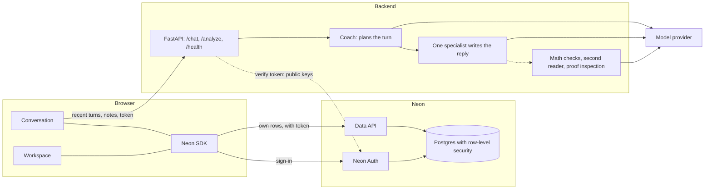

# Hetu

Hetu is an open source learning environment for any academic subject. A student says what they are working on, and Hetu works out what kind of help fits that moment: an explanation, an example, a hint, a question about their reasoning, or a second look at its own feedback.

Live site: https://hetu-cin8.onrender.com

The name comes from the Sanskrit word हेतु, which is associated with reason, cause, or the ground of an inference.

## Overview

Students can use Hetu as guests, with nothing saved, or sign in to keep their conversations, notes, and workspace. The interface is a conversation with a workspace beside it. Behind it, a learning coach plans each turn and a subject specialist writes the reply.

## Educational purpose

Most AI tools respond the same way to every message. A chatbot explains. A Socratic tutor asks questions. A checker looks for mistakes. Each fails when the student needs one of the other two.

Hetu decides first and answers second. A student who says "I have no idea how classes work" is taught. A student who writes out a proof gets feedback on the step that does not follow, without the proof being finished for them. A student who disagrees with that feedback gets a real reconsideration. The student can also choose the kind of help directly.

## Implemented features

Learning

- **Conversation.** A chat that keeps context across turns. Replies render Markdown, typeset math, and formatted code.
- **Starting points.** Three optional starting points: understand something, work through a problem, or examine my reasoning. The choice is sent with every message of the session.
- **Student-chosen help.** A selector in the composer asks for one kind of help with the next message: explain, hint, check my reasoning, example, let me try, or challenge my assumption. The choice decides Hetu's action for that turn. After each reply, two fitting follow-ups are offered.
- **Adaptive strategy.** Each turn starts with a plan: what the student needs, what Hetu should do, and who should answer. Level is judged from what the student has shown, not from vocabulary or one message.
- **Five specialists.** Mathematics, science, programming, writing and humanities, and logic. Only the one that fits a turn is used, unless a question spans two subjects.
- **Exact checks in mathematics.** Integer counterexample search and symbolic comparison of expressions. Results are shown apart from the reply and labelled as computed.
- **A second reader in logic.** Before the logic specialist says an argument has a flaw, a second agent checks whether the flaw is really there.
- **Session notes.** Four groups: discussed, shown by the student, possible misconceptions, and still exploring. Only the student's own words and work count as shown. The student can remove any note, and Hetu does not add it back.

Workspace

- **Draft.** A panel for longer work, beside the conversation on wide screens and in its place on narrow ones. **Get feedback** sends the whole draft to the conversation. Selecting text offers **Ask about the selection**, which quotes it in the composer.
- **Structure.** **Map the steps** lays out a proof or derivation step by step. A graph is drawn only for three or more steps with two or more dependencies. Each step can be revised, asked about, or challenged. No step is ever marked as verified.

Accounts

- **Sign-in.** Google, GitHub, and email with password, through Neon Auth. Email addresses are confirmed with a code. Forgotten passwords are reset with a code.
- **Saved work.** A signed-in student's conversations, session notes, and workspace draft are saved as they change. Conversations can be reopened, renamed, and deleted from a history list.
- **Guests.** Guests start immediately. Their work stays in the tab and is not sent to the database. If a guest signs in, Hetu asks before saving their current work to the account.
- **Profile and deletion.** A display name can be set. **Delete my data** removes every conversation, note, draft, and the profile. Removing the sign-in itself depends on Neon Auth; the app reports whether it worked.

Accessibility: keyboard access throughout, a skip link, live regions for status, a text version of the graph, and reduced motion.

## Architecture



One `POST /chat` turn, in `backend/app/tutor.py`:

1. **Plan.** The coach reads the conversation, the notes, and any help the student chose, and returns a typed plan. One structured model call.
2. **Inspect, when called for.** If the student wrote out a proof, the inspection in `backend/app/agents.py` splits it into steps, and a critic subagent can overrule a suspected gap.
3. **Reply.** The specialist named in the plan writes the reply. Specialists are LangChain Deep Agents with their own tools and subagents.

Design decisions:

- **Code routes, the model plans.** The model fills in the plan and ordinary code acts on it. A help option the student chose sets the action in code.
- **Few calls.** An ordinary turn is two model calls. A proof turn adds one to three.
- **The API stays stateless.** The browser sends recent turns and notes with each request. Saved work goes from the browser to the Neon Data API, so the API never holds database credentials. This keeps one path for data and no duplicate endpoints.
- **Security lives in the database.** Every table has row-level security keyed to the verified token. Child rows reference their conversation together with its owner, so no one can attach a row to someone else's conversation.
- **The API checks identity only for limits.** It verifies Neon Auth tokens with Neon's public keys. A signed-in user is limited per account; anyone else per address.
- **No code execution.** Running student code safely needs a sandbox, which is out of scope.

## Technology stack

| Part | Choice | Why it is here |
| --- | --- | --- |
| Frontend | React, TypeScript, Vite, Tailwind CSS | Component UI with type checking and a small set of design tokens. |
| Reply rendering | react-markdown, remark-gfm, remark-math, rehype-katex | Markdown, tables, math, and code. Raw HTML in a reply is not rendered. |
| Accounts and data | Neon Auth (managed Better Auth), Neon Data API, `@neon/neon-js` | Sign-in, sessions, and per-user data access without a separate auth service. |
| Database | Neon Postgres | Conversations, messages, notes, drafts, profiles. |
| Backend | FastAPI, Uvicorn, Pydantic | A typed HTTP API. |
| Agents | LangChain Deep Agents | Specialists, subagents, and the proof orchestrator. |
| Math checks | SymPy | Symbolic comparison of expressions. |
| Token checks | PyJWT with cryptography | Verifies Neon Auth's Ed25519 signatures. |
| Model access | langchain-groq | The default model is `openai/gpt-oss-120b`, an open weight model on Groq. |
| Tests | pytest, psycopg, Vitest, Testing Library | No automated test calls a model or Neon. |

## Local setup

Prerequisites: [Node.js](https://nodejs.org/) 22.12 or newer and [uv](https://docs.astral.sh/uv/).

Backend:

```bash
cd backend
cp .env.example .env    # then add GROQ_API_KEY
uv sync
uv run uvicorn app.main:app --reload --port 8000
```

Frontend, in a second terminal:

```bash
cd frontend
cp .env.example .env.local
npm install
npm run dev
```

Open http://localhost:5173. Without the Neon settings below, Hetu runs for guests only and shows no **Sign in** button.

## Environment configuration

Backend, in `backend/.env` locally and in the Render service settings:

| Variable | Default | Purpose |
| --- | --- | --- |
| `HETU_LLM_PROVIDER`, `HETU_LLM_MODEL` | unset | Model provider and model. Without them, `POST /chat` answers 503. |
| `GROQ_API_KEY` | unset | Key for Groq. Secret. |
| `HETU_LLM_TEMPERATURE` | `0` | Sampling temperature. |
| `HETU_WORKFLOW` | `deep_agent` | Proof inspection: `deep_agent`, or `direct` with no critic. |
| `HETU_ANALYZE_TIMEOUT_SECONDS` | `60` | Upper bound on one turn. |
| `HETU_CORS_ORIGINS` | `http://localhost:5173` | Browser origins allowed to call the API. |
| `HETU_RATE_LIMIT_PER_MINUTE` | `20` | Requests per client per minute. |
| `HETU_DAILY_ANALYSIS_LIMIT` | `500` | Requests per day for everyone together. |
| `HETU_DAILY_LIMIT_PER_GUEST` | `40` | Requests per day for one guest address. |
| `HETU_DAILY_LIMIT_PER_USER` | `120` | Requests per day for one signed-in account. |
| `HETU_TRUSTED_PROXY_HOPS` | `0` | Proxies that append to `X-Forwarded-For`. `1` on Render. |
| `HETU_NEON_AUTH_URL` | unset | Neon Auth URL, used only to verify tokens. Public. |
| `DATABASE_URL` | unset | Owner connection string, for the scripts on your machine only. Secret. Never set it on Render. |
| `NEON_DATA_API_URL` | unset | For `scripts/check_isolation.py` only. |

Frontend, in `frontend/.env.local` locally and in the Render static site settings. Every `VITE_` value is built into the page and is public:

| Variable | Purpose |
| --- | --- |
| `VITE_API_BASE_URL` | Hetu's API, for example `http://localhost:8000`. |
| `VITE_NEON_AUTH_URL` | Neon Auth URL from the Neon Console. |
| `VITE_NEON_DATA_API_URL` | Data API URL from the Neon Console. |

Neon Console settings:

- **Auth:** enable it on the branch. Add `https://hetu-cin8.onrender.com` to trusted domains. Keep **Allow localhost** on for development only.
- **Google:** Neon's shared credentials work for development. For production, create a Google OAuth client with the redirect URI `<Auth URL>/callback/google`.
- **GitHub:** needs its own OAuth app, with the callback URL `<Auth URL>/callback/github`.
- **Email:** enable sign-up with email and **Verify at sign-up** with **Verification code**. Neon's shared email sender supports codes, not links, and is rate limited. Production use needs a custom SMTP provider.
- **Data API:** enable it with **Use Managed Better Auth**.

## Database setup and migrations

The schema is in `db/migrations`, one SQL file per change, applied in name order. Apply them after enabling Auth and the Data API, because the schema relies on the `authenticated` role and the `auth.user_id()` function that Neon creates then.

```bash
cd backend
# DATABASE_URL in backend/.env, from Connect in the Neon Console
uv run python -m scripts.migrate --status
uv run python -m scripts.migrate
```

The runner records each applied file in the `hetu_meta` schema, which the Data API cannot reach. A file can also be pasted into the Neon SQL Editor.

Tables: `conversations`, `messages`, `learning_states`, `workspaces`, and `profiles`. Each row has an owner taken from the verified token. Messages cannot be edited. Deleting a conversation deletes its messages and notes. Text sizes are capped, and only small extras are stored with each reply, so the history is not duplicated.

Usage on the Free plan: Neon's Free plan FAQ, checked in November 2026, lists 100 CU-hours of compute per project per month and 1 GB of storage per project. Compute that is idle for 5 minutes scales to zero. Reaching a monthly limit suspends compute until the next month; Hetu then keeps working for guests, and signed-in students see that saving is unavailable while their work stays in the tab. To check storage:

```bash
uv run python -m scripts.usage_report
```

It reports the database size against the limit and warns above 80 percent. Compute hours are shown in the Neon Console.

## Testing

```bash
cd backend
uv run pytest
```

150 tests, 16 of which run only with a disposable local Postgres:

```bash
HETU_TEST_DATABASE_URL=postgresql://postgres@localhost:5432/postgres uv run pytest tests/test_rls.py
```

The database tests apply the real migration and act as two users and a guest with plain SQL. They check that no user can read, change, delete, or add to another user's rows, forge an owner, or hand over ownership. Locally, `auth.user_id()` is a stand-in in `db/test/neon_stand_in.sql` that reads the same claim. The other tests cover routing and teaching rules, proof inspection, the math checks, token verification with real Ed25519 keys, and the request limits.

To check isolation on the real Neon project, create two confirmed accounts and run:

```bash
uv run python -m scripts.check_isolation --a-email a@example.com --b-email b@example.com
```

```bash
cd frontend
npm test
npm run build
npm run lint
```

111 tests. They cover the conversation, guest behavior, sign-in, email codes, password reset, saving, reopening, renaming, and deleting conversations, the workspace draft, the save prompt for guest work, failed saves, the reasoning graph, and the API client. Neon is replaced by fakes in these tests.

To see a real model's behavior, which the provider may bill: `uv run python -m scripts.evaluate_scenarios`.

## Security and privacy

- Groq keys and the database connection string stay off the frontend. The browser holds only public addresses and the signed-in user's own short-lived token.
- Every table has row-level security. A user can reach only rows whose owner matches the `sub` of their verified token. The browser never sends a user id that is trusted.
- The API verifies tokens against Neon Auth's public keys and accepts only EdDSA signatures with the expected issuer, audience, and expiry. An invalid token is treated as a guest.
- Tokens and profile details are not put into model prompts. Student messages, notes, and shared drafts are sent to the model provider.
- Guest work is not sent to the database. A conversation saved in the browser by an earlier version is offered, never deleted without asking.
- Request limits are counted in memory and reset on restart. They slow spending down and do not cap it. Set a spend limit with the provider.

## Known limitations

- Hetu is a language model. It can be wrong. Nothing is formally verified.
- No study with students has been done. The scenario script checks routing, not teaching quality.
- Session notes are tentative readings of one conversation, not a measure of what a student knows.
- A request carries at most the last 24 messages.
- The isolation of saved data has been tested on a local Postgres with a stand-in for Neon's `auth.user_id()`. Run `scripts.check_isolation` to confirm it on Neon.
- Neon Auth may not allow an account to delete its own sign-in. Then **Delete my data** removes everything Hetu stores, and the sign-in record (email and name) remains.
- The workspace holds one draft per account.
- The reasoning graph exists only for mathematical arguments.
- Hetu cannot run code, browse, or read files and images.
- Automated accessibility checks pass. The interface has not been tested with a screen reader.

## License

The application code is licensed under the Apache License 2.0. See `LICENSE` and `NOTICE`.

The license covers this code only. The language models, Neon, and the provider's service are separate works with their own terms.
